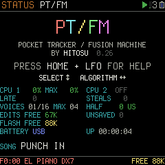
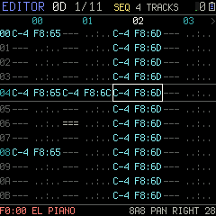
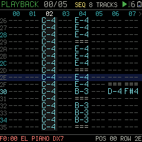
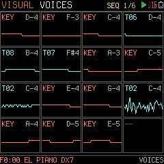
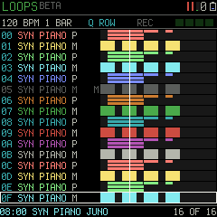
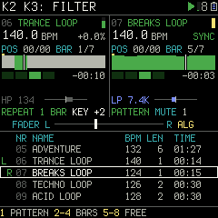

# PT/FM

**Pocket Tracker / Fusion Machine**: a tracker firmware for the M-VAVE FM-1 synthesizer, in the
ProTracker tradition, whose tracks play synth engines and samples side by side.

**https://hitosu.github.io/ptfm/**: install it, try it in the emulator, read the manual, open the editor.

**Video:** [INTRODUCING PT/FM](https://youtu.be/95bZPtyD5rE) on YouTube.

**Status:** the firmware runs on the FM-1 and is being made lighter, so more voices play at once
(`dist/firmware/install.html` installs it and uploads the demo disk). Its **MIDI CONTROLLER** (SETTINGS' MIDI
page) turns the FM-1 into a USB-MIDI controller, for the virtual FM-1 or any synth or DAW
([specs/controller.md](specs/controller.md)).

## What is here

| Folder | What |
|---|---|
| `specs/` | the specifications ([specs/README.md](specs/README.md)) |
| `playground/` | a virtual FM-1 in the browser, for trying the UI, with sound: open `playground/index.html` in Chrome or Edge, click to start the sound |
| `panel/` | the virtual FM-1 itself, shared by the playground and the emulator |
| `demo-disk/` | the demo disk: patches, samples and songs under free licences, to show what PT/FM does ([demo-disk/README.md](demo-disk/README.md)) |
| `fw/` | the firmware ([fw/README.md](fw/README.md)) |
| `emulator/` | the firmware running in a browser: open `emulator/index.html` |
| `dist/` | the built files, a folder for each kind of build: `firmware/install.html` installs the firmware and uploads the demo disk; `debug/install.html` installs the debug build and shows its figures; `emulator/` what the emulator loads, and `emulator/emulator.html` the emulator as one file to share; `playground/playground.html` the playground as one file to share |
| `site/` | the web site, https://hitosu.github.io/ptfm/ ([specs/site.md](specs/site.md)): the landing, and `assemble.sh`, which puts it together with the pages above for `.github/workflows/pages.yml` to publish |
| `tools/`, `tests/`, `assets/` | build scripts, host tests, fonts |

The layout in full: [specs/layout.md](specs/layout.md). What changed from version to version:
[CHANGELOG.md](CHANGELOG.md).

## Licence

GPL-3.0-only (`LICENSE`). Copyright (C) 2026 Vasily Kazantsev.

- PT/FM builds on SLOOP / Felucca by Leo Kuroshita (@kurogedelic), Hügelton Instruments
  (GPL-3.0-only). Files taken from it keep their copyright lines.
- The second core's start and hold follow work by Charles Vestal, Kerem Kilic and zednaked
  (GPL-3.0-only); the files that follow it carry their copyright lines.
- The Terminus fonts are SIL OFL 1.1 (`assets/fonts/Terminus-LICENSE.txt`).
- The firmware packages carry three files of JieLi's AC79 SDK (Apache-2.0).
- The demo disk carries its own licences, all free: [demo-disk/CREDITS.md](demo-disk/CREDITS.md).
- Each file's header names its licence.

No warranty: custom firmware is installed at your own risk. M-VAVE and FM-1 are trademarks of
their owners; PT/FM is not affiliated with them.
